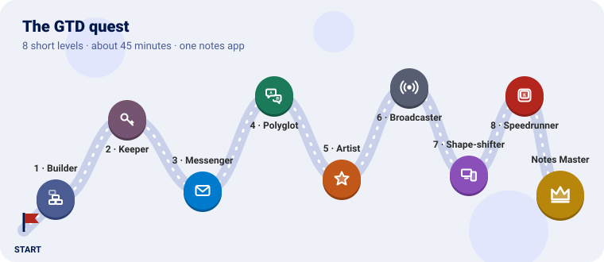

# Welcome to GTD 👋

**GTD** (*Getting Things Done*) is a tiny TypeScript library for building web applications.

It has one idea: **the browser already knows how to build apps — GTD just makes it shorter to
write.** There is no virtual DOM, no special syntax, no compiler plugin and nothing to "learn
instead of" JavaScript. A button made with GTD is a normal `<button>`. A request made with GTD is a
normal `fetch`. If you know a little HTML and TypeScript, you already know most of GTD.

```ts
import { uiComponent } from "./gtd/dom.js"

const title = uiComponent({ type: "h1", text: "Hello, world!" })
document.body.appendChild(title)
```

That is a complete GTD program. 🎉

**No Node.js, no npm.** You copy GTD's files into your project and build with
[esbuild](https://esbuild.github.io), a single program. No `node_modules`, no configuration files.

## Is GTD for me?

GTD is a good fit when you want:

- ✅ A small app, a tool, a dashboard or a personal site, without a big framework.
- ✅ To understand every line that runs in your page.
- ✅ To learn how the web platform works, while still writing less code.

You may want something else when you need server-side rendering, a large component ecosystem or
automatic re-rendering when data changes.

## Where to start

New here? Follow these in order — the first two take about **10 minutes** together.

[](4-the-quest.md)

| Step | Page | Time |
|---|---|---|
| 1 | [Getting started](2-getting-started.md) — create a project and see it in the browser | 5 min |
| 2 | [How GTD thinks](3-core-ideas.md) — the six ideas behind every module | 5 min |
| 3 | [The GTD quest](4-the-quest.md) — build a notes app in 8 short levels | 45 min |
| 🆘 | [Troubleshooting](7-troubleshooting.md) — blank page? errors in the console? look here | — |

## Guides — one per thing you want to do

| I want to… | Read | Module |
|---|---|---|
| Put things on the screen | [Building the interface](5-guides/1-building-the-interface.md) | `dom.ts` |
| Have several pages | [Views and routing](5-guides/2-views-and-routing.md) | `router.ts`, `view.ts` |
| Load or send data to a server | [Talking to a server](5-guides/3-talking-to-a-server.md) | `http.ts` |
| Let parts of my app react to each other | [Signals](5-guides/4-signals.md) | `signals.ts` |
| Show my app in several languages | [Translations](5-guides/5-translations.md) | `i18n.ts` |
| Remember user settings | [Configuration](5-guides/6-configuration.md) | `configuration.ts` |
| Show icons | [Icons](5-guides/7-icons.md) | `icons.ts` |
| React to keyboard shortcuts | [Keyboard shortcuts](5-guides/8-keyboard-shortcuts.md) | `shortcuts.ts` |

## Small helpers

| I want to… | Read | Module |
|---|---|---|
| Know the screen size, dark mode or the device | [Browser](6-reference/1-browser.md) | `browser.ts` |
| Style the page differently on phones | [Display](6-reference/2-display.md) | `display.ts` |
| Type text letter by letter, or fade things in | [Animations](6-reference/3-animations.md) | `animations.ts` |
| Wait some milliseconds | [Time](6-reference/4-time.md) | `time.ts` |
| Make it look good (buttons, cards, dark theme) | [HTML tags and Bubble UI](6-reference/5-tags-and-styles.md) | `bubble.ts`, `html.ts` |
| Read parts of a URL or download a file | [Paths](6-reference/6-paths.md) | `paths.ts` |
| Generate a random unique id | [Crypto](6-reference/7-crypto.md) | `crypto.ts` |

## Helping with GTD

| Page | What it covers |
|---|---|
| [Contributing and testing](8-contributing.md) | Running the tests, code style, writing these docs |

## All the modules at a glance

Each module is one file. If you copy a module on its own, copy the modules it **depends on** too.

| Module | Depends on | What it gives you |
|---|---|---|
| `dom.ts` | — | `uiComponent` and helpers to change elements |
| `view.ts` | — | The `viewHandler` type |
| `router.ts` | `view.ts` | `setRoute`, `setHomeRoute`, `setNotFoundRoute`, `showRoute` |
| `http.ts` | — | `httpGet`, `httpPost`, `httpPut`, `httpPatch`, `httpDelete`, `httpHead`, `httpOptions`, `handleResponseStatus` |
| `signals.ts` | `crypto.ts` | `setSignal`, `connectToSignal`, `disconnectSignal`, `emitSignal` |
| `i18n.ts` | — | `setCurrentLanguage`, `loadTextBundle`, `getText` |
| `configuration.ts` | — | `loadConfiguration`, `setConfiguration`, `getConfiguration`, `isConfigurationSet`, `isConfigurationActive` |
| `icons.ts` | `dom.ts` | `loadIcons`, `getIcon` |
| `browser.ts` | — | `isSmallDevice`, `prefersDarkMode`, `isMobile`, `getOs`… |
| `paths.ts` | — | `getUrlGetParameters`, `downloadFile`… |
| `crypto.ts` | — | `uuidv4` |
| `display.ts` | `browser.ts`, `configuration.ts`, `dom.ts` | `checkDisplayType`, `isMobileDisplay` (default) |
| `shortcuts.ts` | `crypto.ts` | `Shortcuts` (default), `KeyInteraction`, `Shortcut` |
| `animations.ts` | `html.ts`, `time.ts` | `Animations` (default) |
| `time.ts` | — | `sleep`, `sleepIf` |
| `html.ts` | — | `Html` (tag names) |
| `bubble.ts` | — | `BubbleUI` (class names of `styles/bubbleui-v3.0.0.css`) |
