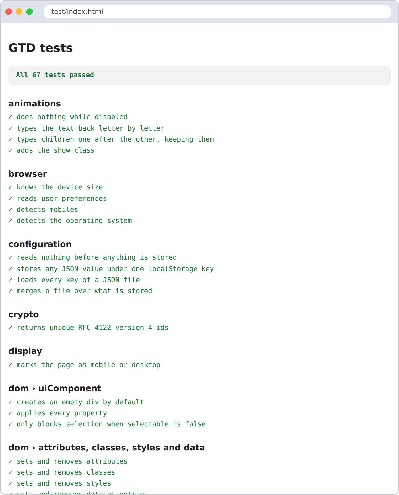

# Contributing and testing

## Layout

```
src/          the library, one module per file
test/         unit tests, one file per module (dom.test.ts tests dom.ts)
test/lib/     the small test runner
bin/          esbuild, and scripts to test and check types
docs/         this documentation, published to GitHub Pages
```

## No Node.js

Like the apps made with it, GTD itself needs no Node.js or npm. Everything runs with the files in
`bin/`, a shell and a browser.

| Command | What it does |
|---|---|
| `bin/test.sh` | Builds the tests with esbuild and runs them in headless Chrome or Chromium |
| `bin/test.sh --build` | Only builds them; open `test/index.html` in any browser to see the results |
| `bin/install-ts.sh` | Downloads the native TypeScript compiler (`bin/tsgo`) with curl, once |
| `bin/tsgo -p .` | Checks the types of `src/` and `test/` |

If your Chrome is not found, point to it: `CHROME=/path/to/chrome bin/test.sh`.

`test/index.html` is also a visual report: green for passing tests, red for failing ones, with the
reason.



GitHub runs the type check and the tests on **every push and pull request**
(`.github/workflows/test.yaml`).

## Writing a test

```ts
import { describe, expect, it, mock } from "./lib/test.js"
import { setDomEvents } from "../src/dom.js"

describe("dom", () => {
  it("adds listeners", () => {
    const button = document.createElement("button")
    const click = mock(() => {})
    setDomEvents(button, { click })
    button.click()
    expect(click).toHaveBeenCalledTimes(1)
  })
})
```

Then import the new file in `test/index.ts`.

| Helper | Use it to |
|---|---|
| `expect(x).toBe / toEqual / toContain / toMatch / toBeTruthy / toBeFalsy` | Check values |
| `mock(fn?)` | Make a function that remembers its calls; check with `toHaveBeenCalledTimes` / `toHaveBeenCalledWith` |
| `fakeFetch({ path: body })` | Answer `fetch` from memory during the test (404 for other paths) |
| `replace(object, key, value)` | Swap a property, like `window.matchMedia`, during the test |
| `quiet("error" \| "warn")` | Silence and count console messages during the test |
| `afterThis(fn)` | Clean up after the test, even when it fails |

Some habits that keep the suite reliable:

- **Network:** never call a real server; use `fakeFetch`.
- **Module state:** `router.ts` and `i18n.ts` keep state for the whole page. Their tests run in
  order and build on each other; add new ones at the end.
- **The page:** remove what you add to `document.body` with `afterThis`.

## Conventions

- Every exported function has a JSDoc comment.
- Compare with the constant first: `undefined == value`, `false == buffer.has(id)`.
- A module imports its siblings with `.js` (`./dom.js`), as TypeScript and esbuild expect.
- A new module gets a test file and a page in `docs/`, linked from `docs/README.md`.

## Documentation

GTD is simple, and its docs should feel the same. Someone who has never used it should have
something on screen in minutes. When you write a page:

- **Start with "In 30 seconds"**: the smallest example that works, then explain.
- **Show, then tell**: code first, then a table or a sentence about it.
- **Write for a junior**: short sentences, plain words, explain any term the first time
  (or link [How GTD thinks](concepts.md)).
- **Every example must run** as written: imports with `.js`, `await` where needed.
- **End with a full example and "Common mistakes"** when the module has pitfalls.
- **Link both ways**: from `docs/README.md` to the page, and back with `[← All the documentation]`.

The `docs/` folder is published with [papiro](https://github.com/akrck02/papiro) by
`.github/workflows/publish-docs.yaml` on every push to `main`. Link pages with relative `.md` links:
they work on GitHub and papiro turns them into site links.

GitHub Pages must serve the `gh-pages` branch: **Settings → Pages → Deploy from a branch →
`gh-pages` / root**.

---

[← All the documentation](README.md)
