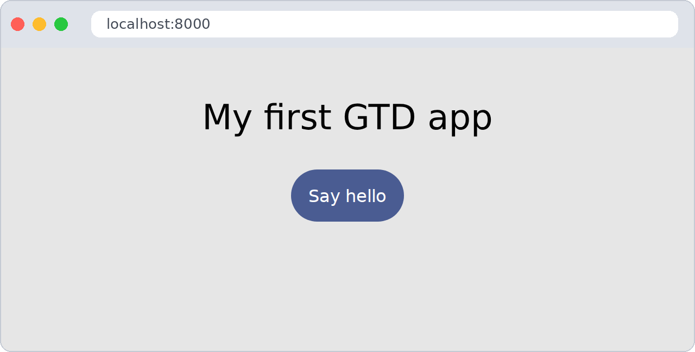
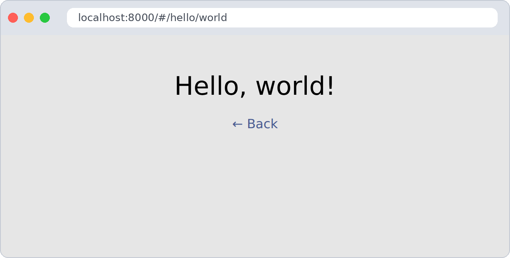
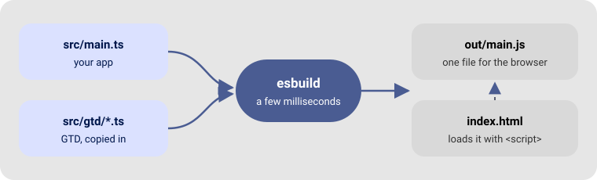

# Getting started 🚀

| | |
|---|---|
| 🎯 **Goal** | Your first GTD app in the browser: two pages and a button |
| ⏱️ **Time** | About 5 minutes |
| 🧰 **You need** | A terminal, git and Python 3 — no Node.js |
| 🗺️ **Then** | [The GTD Quest](tour.md): 8 levels, a boss and 9 badges |

Think of this page as **level 0, the base camp** ⛺: you set up your tools here, and the adventure
starts on the next page.

---

## No Node.js, no npm

GTD does **not** use Node.js, npm or `node_modules`. You need only two small programs:

| Tool | What it does | Size |
|---|---|---|
| [**esbuild**](https://esbuild.github.io) | Turns your TypeScript into one JavaScript file for the browser | one file, ~10 MB |
| **Python 3** | Serves the page on `localhost` while you work (already installed on Linux and macOS) | — |

Nothing gets installed globally, there is no `package.json`, and your project folder stays tiny.

> 💡 **Why a local server?** Browsers refuse to load scripts from a file opened by double-click
> (`file://…`) in many cases. Any static server works; Python's is just already there.

---

## Step 1 — Get GTD 📦

```sh
git clone --depth 1 https://github.com/akrck02/gtd gtd-download
mkdir -p my-app/src my-app/bin
cp -r gtd-download/src my-app/src/gtd
cp -r gtd-download/styles my-app/styles
cd my-app
```

GTD is not a package you install: it is a folder of source files that you **copy into your
project**. You own them — you can read them, and even change them.

The `styles/` folder holds **Bubble UI**, the stylesheet that goes with GTD: nice buttons, colours,
a dark theme and layout classes, in one 9 KB file. It is optional, but it makes your app look good
from the first minute.

---

## Step 2 — Get esbuild 🔧

esbuild is a **blender** 🥤: you put in many `.ts` files — yours and GTD's — and get **one**
`.js` file the browser can drink.


**On Linux (x86-64)** the GTD repository already ships it:

```sh
cp ../gtd-download/bin/esbuild bin/
```

**On macOS, Windows or ARM**, use esbuild's own installer, which downloads a single file:

```sh
curl -fsSL https://esbuild.github.io/dl/v0.25.8 | sh
mv esbuild bin/
```

Check it works:

```sh
./bin/esbuild --version     # 0.25.8
```

Your project now looks like this:

```
my-app/
├── bin/
│   └── esbuild        ← the builder
├── styles/
│   └── bubbleui-v3.0.0.css   ← the looks
└── src/
    └── gtd/           ← GTD, one file per module
        ├── dom.ts
        ├── router.ts
        └── …
```

---

## Step 3 — Write the page 📄

Create **`index.html`** in `my-app/`:

```html
<!doctype html>
<html lang="en">
  <head>
    <meta charset="utf-8">
    <meta name="viewport" content="width=device-width, initial-scale=1">
    <title>My app</title>
    <link rel="stylesheet" href="./styles/bubbleui-v3.0.0.css">
    <style>
      #app { padding: 2rem; gap: .5rem; }
    </style>
  </head>
  <body>
    <main id="app" class="box-column box-center"></main>
    <script type="module" src="./out/main.js"></script>
  </body>
</html>
```

`<main id="app">` is the box where our pages will be drawn; Bubble's `box-column box-center`
classes stack what we put in it and centre it. The `<script>` loads our code — it points to
`out/main.js`, the file esbuild will **build**, not to the `.ts` file.

---

## Step 4 — Write the app ✍️

Create **`src/main.ts`**:

```ts
import { uiComponent, setDomEvents } from "./gtd/dom.js"
import { setRoute, showRoute } from "./gtd/router.js"
import { BubbleUI } from "./gtd/bubble.js"

// 1. Find the box where pages are drawn
const app = document.getElementById("app")

// 2. Describe the home page
setRoute("/", async (_params, container) => {
  const title = uiComponent({ type: "h1", text: "My first GTD app" })
  const button = uiComponent({ type: "button", text: "Say hello", classes: [BubbleUI.Primary] })

  setDomEvents(button, {
    click: () => location.hash = "/hello/world",
  })

  container.append(title, button)
})

// 3. Describe a second page; "$" means "any word here"
setRoute("/hello/$", async ([name], container) => {
  const greeting = uiComponent({ type: "h1", text: `Hello, ${name}!` })
  const back = uiComponent({ type: "a", text: "← Back", attributes: { href: "#/" } })
  container.append(greeting, back)
})

// 4. Draw the right page now, and every time the address changes
const navigate = () => showRoute(location.hash.slice(1) || "/", app)
window.addEventListener("hashchange", navigate)
navigate()
```

> 💡 The imports end in **`.js`** even though the files are `.ts`. That is the standard way to
> write imports in TypeScript for the browser, and esbuild understands it.

---

## Step 5 — Build and run ▶️

```sh
./bin/esbuild src/main.ts --bundle --format=esm --outfile=out/main.js
python3 -m http.server 8000
```

The first command reads `main.ts`, follows every `import`, and writes **one** file,
`out/main.js`. It takes a few milliseconds.

Open **<http://localhost:8000>** in your browser. You should see:



Click **Say hello** → the address ends in `#/hello/world` and the page greets you:



Click **← Back** → you are home again. Try typing `#/hello/Ada` in the address bar too.

🎉 **That's it — you have a GTD app with routing.** Base camp done: you are ready for the quest.

Nothing on screen? Head to [Troubleshooting](troubleshooting.md).

---

## Making changes 🔁

Leave esbuild **watching** in a second terminal; it rebuilds every time you save:

```sh
./bin/esbuild src/main.ts --bundle --format=esm --outfile=out/main.js --watch
```

Then just reload the browser after each change.

## Getting ready to publish 🌍

Add `--minify` to make the file small, and copy `index.html` and `out/` to any static host
(GitHub Pages, Netlify, your own server…):

```sh
./bin/esbuild src/main.ts --bundle --format=esm --minify --outfile=out/main.js
```

## Checking types (optional) 🔍

esbuild builds fast because it **does not check types**: a typo like `contaner` shows up in the
browser, not in the terminal. Editors such as VS Code check types as you type. To check from the
terminal too, the GTD repository has a script that downloads the native TypeScript compiler, again
without Node:

```sh
cp ../gtd-download/bin/install-ts.sh bin/
./bin/install-ts.sh        # downloads bin/tsgo once
./bin/tsgo --noEmit --strict false --target ES2022 --module ESNext --lib ES2022,DOM,DOM.Iterable src/main.ts
```

---

## What just happened? 🤔



| You wrote | What it does |
|---|---|
| `uiComponent({...})` | Creates a real HTML element — see [Building the interface](guides/dom.md) |
| `BubbleUI.Primary` | The name of Bubble's `primary` class: the blue, rounded button — see [HTML tags and Bubble UI](reference/html.md) |
| `setDomEvents(button, { click })` | Adds a click listener — same as `addEventListener` |
| `setRoute("/hello/$", view)` | Says which function draws which address — see [Views and routing](guides/router.md) |
| `showRoute(path, app)` | Clears `app` and draws the matching page |

---

## Next: choose your path 🧭

| | Path | What you get |
|---|---|---|
| 🗺️ | **[Start the GTD Quest](tour.md)** (recommended) | Build a notes app in 8 levels and a boss. Learn by doing, earn 9 badges |
| 🧠 | [How GTD thinks](concepts.md) | Six ideas, five minutes, every other page becomes easier |
| 📚 | [The guides](README.md#guides--one-per-thing-you-want-to-do) | Look up one thing when you need it |

---

[← All the documentation](README.md)
