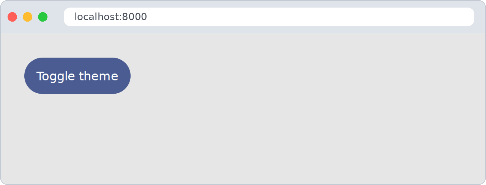
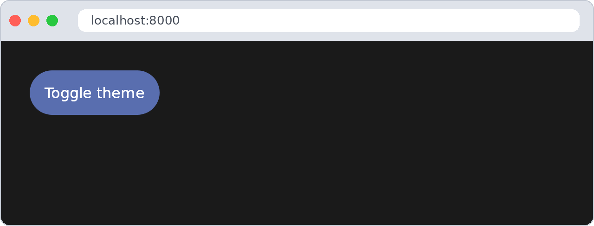

# Configuration ⚙️

**Module:** `configuration.ts` · **Depends on:** nothing

Store settings — the API address, the theme, the language — so they **survive reloads**. They are
kept in the browser, on the user's device, as one JSON object.

## In 30 seconds

```ts
import { setConfiguration, getConfiguration } from "./gtd/configuration.js"

setConfiguration("theme", "dark")
getConfiguration("theme") // "dark", even after closing the browser
```

## First step: name your configuration

Open `src/gtd/configuration.ts` and change the id to your app's name:

```ts
const configurationId: string = "my-notes-app"
```

All your settings are saved together under that name. Two apps on the same address (for example
both on `localhost:8000`) with the same id would share — and overwrite — their settings.

## Reading and writing

| Function | What it does |
|---|---|
| `setConfiguration(key, value)` | Saves `value` under `key` |
| `getConfiguration(key)` | Returns the value, or `undefined` if it was never saved |
| `isConfigurationSet(key)` | `true` if `key` has a value |
| `isConfigurationActive(key)` | `true` only if the value is exactly `true` — handy for on/off options |
| `await loadConfiguration(path)` | Saves every key of a JSON file |

Values can be **anything JSON can hold**: text, numbers, booleans, lists and objects. They come
back with the same type:

```ts
setConfiguration("fontSize", 18)
setConfiguration("favourites", ["1", "4"])
setConfiguration("animations", true)

getConfiguration("fontSize") + 2         // 20
getConfiguration("favourites").length    // 2
isConfigurationActive("animations")      // true
```

## Defaults from a file

Put the defaults in **`config.json`**, next to `index.html`:

```json
{
  "api": "https://example.org/api",
  "theme": "light",
  "animations": true
}
```

and load it when the app starts:

```ts
await loadConfiguration("./config.json")
```

Each key of the file is saved; keys that are only in the browser are kept. If a key is in both,
**the file wins**. To keep what the user chose, load the file only the first time:

```ts
if (!isConfigurationSet("api"))
  await loadConfiguration("./config.json")
```

## Full example: a theme switch that remembers

Bubble UI has a dark theme built in: it turns on with `data-theme="dark"` on `<html>`.

```ts
import { uiComponent, setDomEvents } from "./gtd/dom.js"
import { getConfiguration, setConfiguration } from "./gtd/configuration.js"
import { prefersDarkMode } from "./gtd/browser.js"
import { BubbleUI } from "./gtd/bubble.js"

function applyTheme(theme: string) {
  document.documentElement.dataset.theme = theme // Bubble UI: "light" or "dark"
}

// use the saved theme, or the system preference the first time
let theme = getConfiguration("theme") ?? (prefersDarkMode() ? "dark" : "light")
applyTheme(theme)

const toggle = uiComponent({ type: "button", text: "Toggle theme", classes: [BubbleUI.Primary] })
setDomEvents(toggle, {
  click: () => {
    theme = "dark" == theme ? "light" : "dark"
    setConfiguration("theme", theme)
    applyTheme(theme)
  },
})
document.body.append(toggle)
```

| Light | Dark |
|---|---|
|  |  |

## Good to know

- Settings are saved in `localStorage`: per site and per browser, so they don't travel between
  devices.
- Users can clear them at any time, so always have a default.
- Don't store passwords or other secrets there: any script on the page can read them.
- To see what's stored: developer tools → *Application* (*Storage* in Firefox) → *Local Storage* →
  your `configurationId`.

---

[← All the documentation](../README.md) · Next: [Icons →](icons.md)
