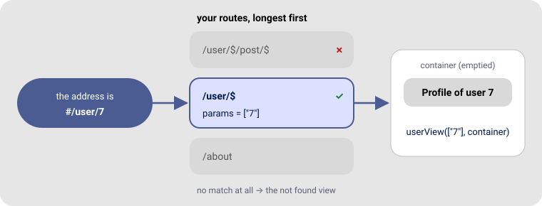

# Views and routing 🧭

**Modules:** `router.ts`, `view.ts` · **Depend on:** nothing

Most apps have more than one page: a home, a profile, settings… The **router** decides which page
to draw for the current address.

## In 30 seconds

```ts
import { setRoute, showRoute } from "./gtd/router.js"

setRoute("/", async (_params, container) => { container.textContent = "Home" })
setRoute("/about", async (_params, container) => { container.textContent = "About us" })

const app = document.getElementById("app")
const navigate = () => showRoute(location.hash.slice(1) || "/", app)
window.addEventListener("hashchange", navigate)
navigate()
```

Now `#/` shows **Home** and `#/about` shows **About us**.



## Two words: view and route

A **view** is a function that draws one page. It receives two things:

1. `params` — values taken from the address (more on that below).
2. `container` — the element to draw into.

```ts
async function aboutView(params: string[], container: HTMLElement) {
  container.append(uiComponent({ type: "h1", text: "About us" }))
}
```

Its type is `viewHandler`, from `view.ts`, if you want to write it down:

```ts
import { viewHandler } from "./gtd/view.js"

const aboutView: viewHandler = async (params, container) => { /* … */ }
```

A **route** links an address to a view:

```ts
setRoute("/about", aboutView)
```

## Addresses with values in them

Put a **`$`** where the address has a value that changes. The view receives the values, in order,
in `params`:

```ts
setRoute("/user/$", async ([userId], container) => {
  container.textContent = `Profile of user ${userId}`
})

setRoute("/user/$/post/$", async ([userId, postId], container) => {
  container.textContent = `Post ${postId} by user ${userId}`
})
```

| Address | View | `params` |
|---|---|---|
| `/user/7` | `/user/$` | `["7"]` |
| `/user/7/post/42` | `/user/$/post/$` | `["7", "42"]` |

Values always arrive as **strings**. Convert them if you need numbers: `Number(userId)`.

## Home and "not found"

- `"/"` (or `""`) is the home page. You can also set it with `setHomeRoute(view)`.
- When no route matches, the **not found** view is shown. Set your own:

```ts
import { setNotFoundRoute } from "./gtd/router.js"

setNotFoundRoute(async (_params, container) => {
  container.append(
    uiComponent({ type: "h1", text: "Oops, this page does not exist" }),
    uiComponent({ type: "a", text: "Go home", attributes: { href: "#/" } }),
  )
})
```

Until you set them, GTD shows the words `Home page.` and `Page not found.`.

## Showing a page

`showRoute(path, container)`:

1. Empties `container`.
2. Finds the route that matches `path`.
3. Calls its view with the values and the container.

To **add** a page below what the container already has, instead of replacing it, pass `false`:
`showRoute("/comments", container, false)`.

GTD does **not** listen to the address bar by itself — you choose how. There are two common ways.

### Option A — hash addresses (recommended to start)

Addresses look like `example.org/#/user/7`. They work on **any** host, GitHub Pages included,
without configuring a server.

```ts
const app = document.getElementById("app")
const navigate = () => showRoute(location.hash.slice(1) || "/", app)

window.addEventListener("hashchange", navigate) // when the address changes
navigate()                                     // and once at start
```

Move to another page with a normal link, or from code:

```ts
uiComponent({ type: "a", text: "Profile", attributes: { href: "#/user/7" } })
location.hash = "/user/7"
```

### Option B — clean addresses (`/user/7`)

Uses the History API. Looks nicer, but the **server must answer every address with `index.html`**,
or reloading a page gives a 404.

```ts
function go(path: string) {
  history.pushState({}, "", path)
  showRoute(path, app)
}

window.addEventListener("popstate", () => showRoute(location.pathname, app)) // back / forward
showRoute(location.pathname, app)

// to navigate: go("/user/7")
```

## How a route is chosen

You rarely need to think about this, but if two routes compete:

- Routes with **more segments are tried first**: for `/docs/intro`, `/docs/$` wins over `/docs`.
- A trailing slash is ignored: `"/settings/"` is the same as `"/settings"`.
- `$` matches one segment: anything except `/`.
- A route also matches longer addresses: `/user/$` matches `/user/7/anything`. If you need both,
  register the longer one too.

## Full example: a small site

```ts
import { uiComponent } from "./gtd/dom.js"
import { setRoute, setNotFoundRoute, showRoute } from "./gtd/router.js"

const app = document.getElementById("app")

function menu(): HTMLElement {
  const nav = uiComponent({ type: "nav" })
  nav.append(
    uiComponent({ type: "a", text: "Home", attributes: { href: "#/" } }),
    uiComponent({ type: "a", text: " · Products", attributes: { href: "#/products" } }),
  )
  return nav
}

const products = ["Pencil", "Notebook", "Eraser"]

setRoute("/", async (_, container) => {
  container.append(menu(), uiComponent({ type: "h1", text: "Welcome to the shop" }))
})

setRoute("/products", async (_, container) => {
  container.append(menu(), uiComponent({ type: "h1", text: "Products" }))
  products.forEach((name, index) => {
    const item = uiComponent({ type: "p" })
    item.append(uiComponent({ type: "a", text: name, attributes: { href: `#/products/${index}` } }))
    container.append(item)
  })
})

setRoute("/products/$", async ([index], container) => {
  container.append(menu(), uiComponent({ type: "h1", text: products[Number(index)] ?? "Unknown product" }))
})

setNotFoundRoute(async (_, container) => {
  container.append(menu(), uiComponent({ type: "h1", text: "Not found" }))
})

const navigate = () => showRoute(location.hash.slice(1) || "/", app)
window.addEventListener("hashchange", navigate)
navigate()
```

## Common mistakes

| Symptom | Cause | Fix |
|---|---|---|
| Always "Page not found." | Passing `#/about` instead of `/about` | `location.hash.slice(1)` |
| Clicking links does nothing | No `hashchange` listener | Add it, as above |
| Pages pile up | Drawing into `document.body` | Draw into `container` |
| Reload gives 404 with clean addresses | Server doesn't serve `index.html` for every path | Use hash addresses, or configure the server |

---

[← All the documentation](../README.md) · Next: [Talking to a server →](http.md)
