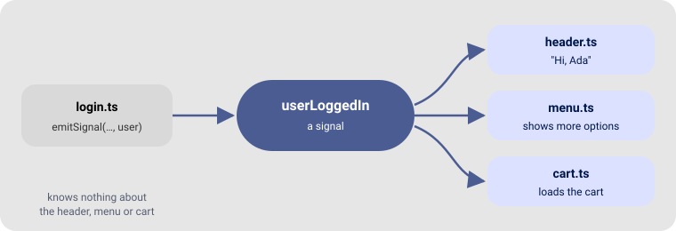

# Signals 📡

**Module:** `signals.ts` · **Depends on:** `crypto.ts`

As an app grows, parts of it need to know when something happens elsewhere: when the user logs in,
the header shows their name, the menu shows more options, the cart loads. A **signal** lets one part
**announce** the event and any number of parts **react**, without importing each other.

If you have used Godot, GTK or Qt, it is the same idea. Elsewhere it is called an *event bus* or the
*observer pattern*.

## In 30 seconds

```ts
import { setSignal, connectToSignal, emitSignal } from "./gtd/signals.js"

const userLoggedIn = setSignal()                       // 1. create

connectToSignal(userLoggedIn, async user => {          // 2. listen
  console.log(`Welcome, ${user.name}!`)
})

await emitSignal(userLoggedIn, { name: "Ada" })        // 3. announce
// → Welcome, Ada!
```



## The three steps

| Step | Function | What it does |
|---|---|---|
| Create | `setSignal()` | Returns a new, unique signal id (a string) |
| Listen | `connectToSignal(id, handler)` | Calls `handler(data)` every time the signal is emitted |
| Announce | `emitSignal(id, data)` | Calls every handler connected to `id`, with `data`, and waits for all of them |
| Stop | `disconnectSignal(id)` | Removes **every** handler of `id`; the signal can be connected again |

## Organising signals in a real app

Create all the signals in **one file**, so everyone imports the same ids:

```ts
// src/events.ts
import { setSignal } from "./gtd/signals.js"

export const userLoggedIn = setSignal()
export const cartChanged = setSignal()
```

```ts
// src/header.ts
import { connectToSignal } from "./gtd/signals.js"
import { userLoggedIn } from "./events.js"

connectToSignal(userLoggedIn, async user => {
  greeting.textContent = `Hi, ${user.name}`
})
```

```ts
// src/cart.ts
connectToSignal(userLoggedIn, async user => loadCart(user.id))
```

```ts
// src/login.ts — knows nothing about the header or the cart
await emitSignal(userLoggedIn, { id: 7, name: "Ada" })
```

Adding a new reaction later means adding one `connectToSignal`, without touching `login.ts`.

## How it behaves

| Situation | What happens |
|---|---|
| Several handlers on one signal | All run, in the order they were connected |
| Emitting a signal that was never created | Nothing |
| Connecting to a signal that was never created | An error in the console; the handler is ignored |
| A handler that takes long (e.g. a request) | `await emitSignal(...)` waits until every handler finished |
| `emitSignal(id)` without data | Handlers receive `undefined` |

Handlers start one after the other but run **at the same time**, so a slow one doesn't delay the
others. But `await emitSignal(...)` waits for the **slowest** one: a handler that should not hold up
the code that emits (an animation, a message that disappears later) should not `await` its slow
part.

### Signals and pages

A view that connects to a signal every time it is drawn would pile up handlers. Connect long-lived
parts of the app (a header, a cart) once, at start. For a signal that belongs to one page, clear it
before drawing the page again:

```ts
setRoute("/chat", async (_, container) => {
  disconnectSignal(messageArrived) // forget the previous visit's handlers
  connectToSignal(messageArrived, async message => container.append(bubble(message)))
})
```

## Typing the data

Handlers receive `any`. Give the data a type to get autocompletion:

```ts
type User = { id: number, name: string }

connectToSignal(userLoggedIn, async (user: User) => {
  user.name // autocompleted
})
```

## Full example: a cart badge

```ts
import { uiComponent, setDomEvents } from "./gtd/dom.js"
import { setSignal, connectToSignal, emitSignal } from "./gtd/signals.js"

const cartChanged = setSignal()
const cart: string[] = []

// the badge only listens
const badge = uiComponent({ type: "span", text: "🛒 0" })
connectToSignal(cartChanged, async (items: string[]) => {
  badge.textContent = `🛒 ${items.length}`
})

// the buttons only announce
const products = ["Pencil", "Notebook"].map(name => {
  const button = uiComponent({ type: "button", text: `Add ${name}` })
  setDomEvents(button, {
    click: () => {
      cart.push(name)
      emitSignal(cartChanged, cart)
    },
  })
  return button
})

document.body.append(badge, ...products)
```

---

[← All the documentation](../README.md) · Next: [Translations →](i18n.md)
