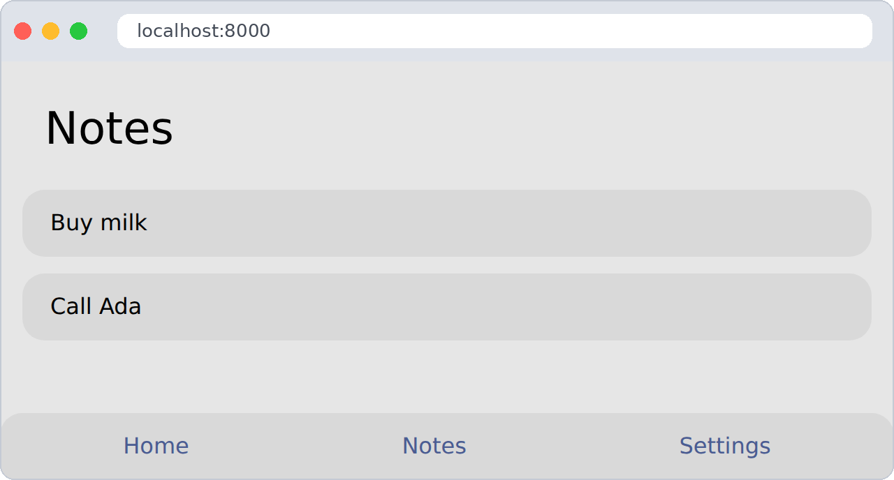
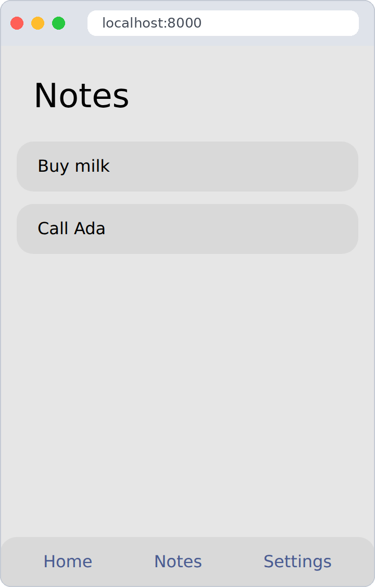

# Display 📱

**Module:** `display.ts` · **Depends on:** `browser.ts`, `configuration.ts`, `dom.ts`

Decides once whether the app looks like a **phone** or a **desktop** app, and writes it on the
page, so CSS and code can adapt.

## In 30 seconds

```ts
import isMobileDisplay, { checkDisplayType } from "./gtd/display.js"

checkDisplayType()
window.addEventListener("resize", checkDisplayType)

if (isMobileDisplay()) showBottomMenu()
```

## What `checkDisplayType` does

It is **mobile** on a phone or tablet, or in a window up to 1024 pixels wide; otherwise **desktop**.
Then it:

1. Sets `data-display` on `<html>`: `<html data-display="mobile">` or `"desktop"`.
2. Saves `"display"` in the [configuration](../guides/configuration.md), which `isMobileDisplay()`
   reads.

## Styling with it

```css
nav { display: flex; gap: 1rem; }

[data-display="mobile"] nav {
  position: fixed;
  bottom: 0;
  justify-content: space-around;
}
```

| Desktop | Mobile |
|---|---|
|  |  |

> 💡 Why not only CSS media queries? Because `data-display` also knows phones held sideways, which
> are wider than 1024 pixels sometimes, and because code can ask the same question with
> `isMobileDisplay()`, so CSS and TypeScript always agree.

---

[← All the documentation](../README.md)
