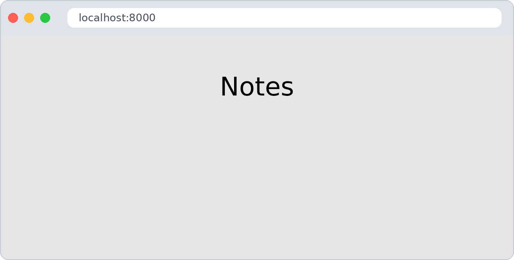
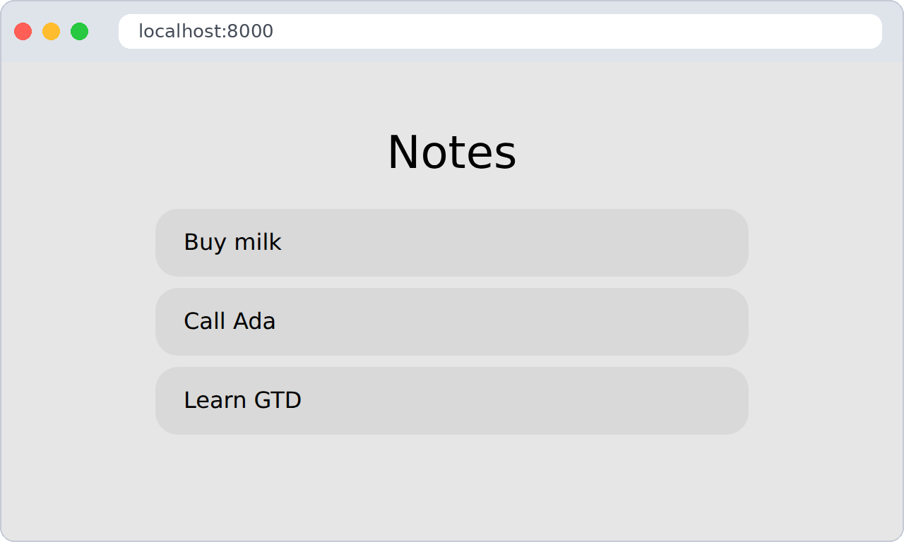
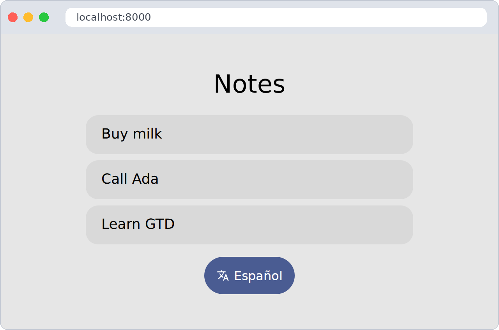
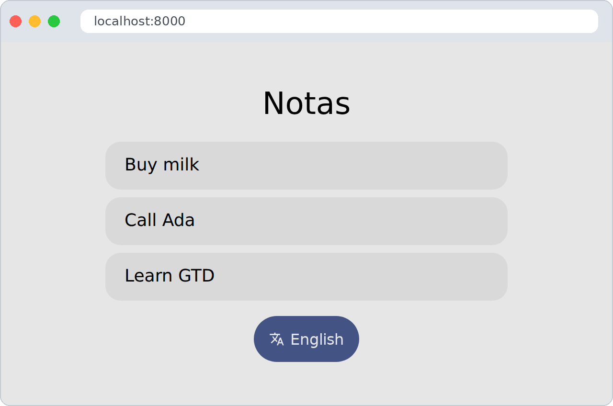
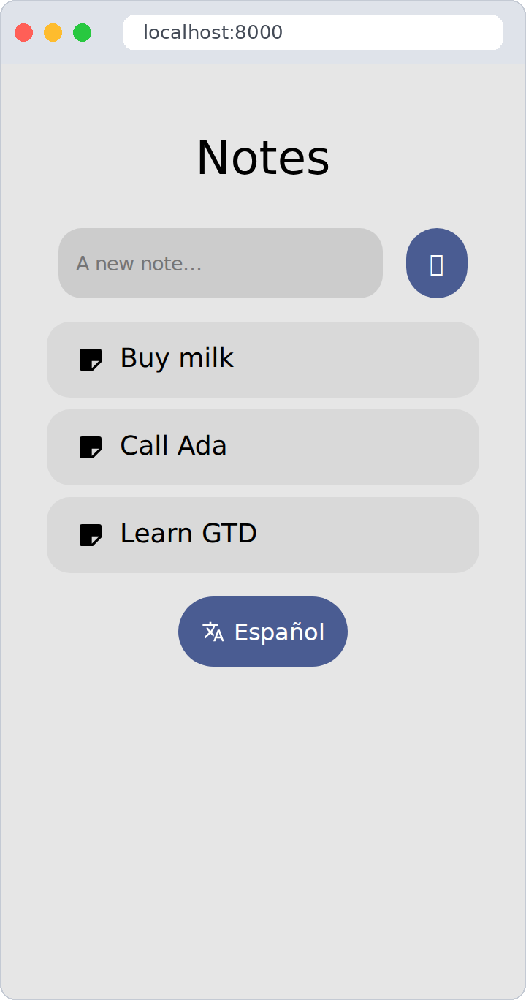
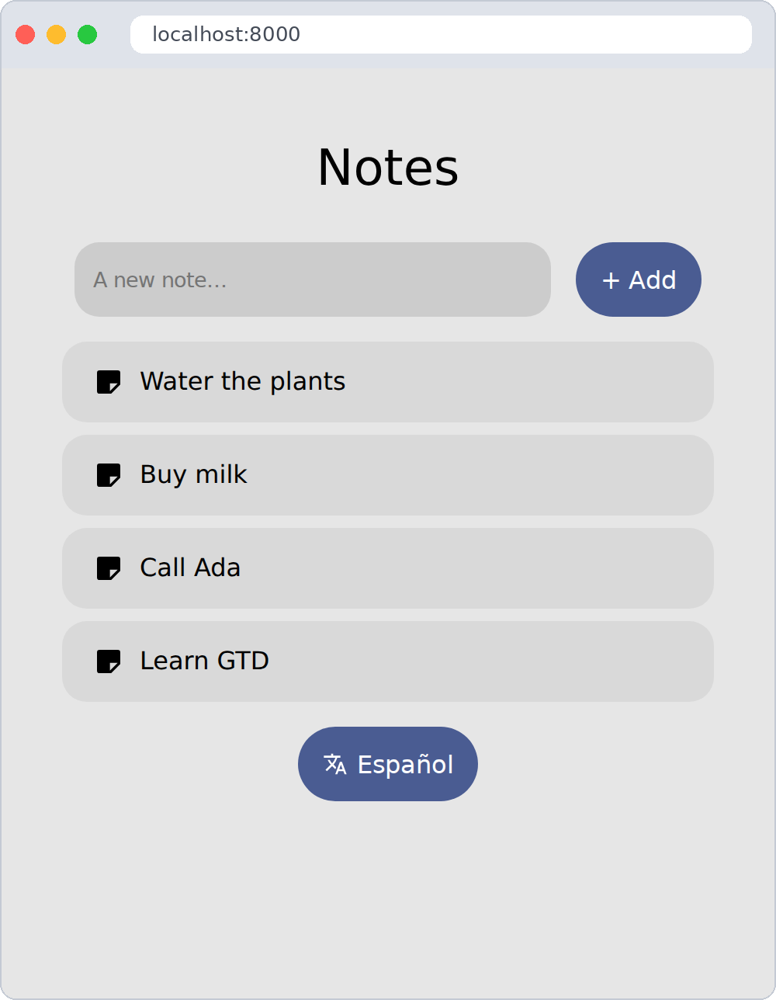
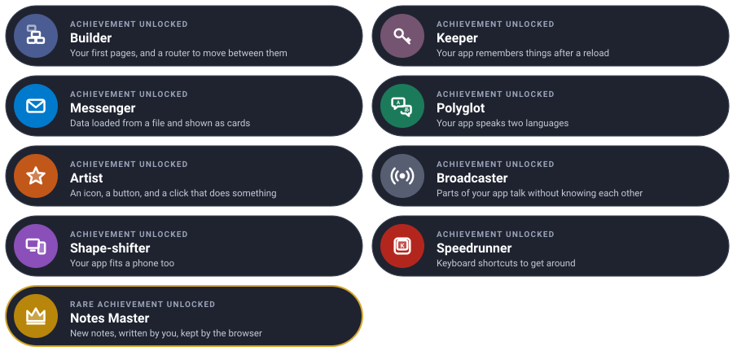

# The GTD quest

Build a small app, one level at a time. Each level teaches one piece of GTD and ends with something
new on your screen.


We will build **Notes**: an app that lists your notes, opens them, speaks English and Spanish and
remembers your choices. At the end, a small challenge: writing new notes.

---

Every level has the same shape: **the idea** (explained with something from everyday life), **the
code**, a **checkpoint** to know it works, and an optional **bonus** if you want a bit more. Go at
your own pace — each level leaves you with a working app.

---

## Before you start

You need the project from [Getting started](getting-started.md) (5 minutes, if you haven't done it
yet). Open **two terminals** in your project folder and leave these running the whole quest:

```sh
# terminal 1 — rebuilds your app every time you save
./bin/esbuild src/main.ts --bundle --format=esm --outfile=out/main.js --watch
```

```sh
# terminal 2 — serves it at http://localhost:8000
python3 -m http.server 8000
```

Now you only need to **save and reload the browser** after each change.

Add this to the `<style>` in your `index.html`; it makes the notes look like cards:

```css
.note { width: 100%; max-width: 420px; padding: 1rem 1.25rem; color: inherit; }
```

This is where everything will live by the end:

```
my-app/
├── index.html
├── config.json                 ← level 2
├── api/notes.json              ← level 3
├── resources/
│   ├── i18n/en/notes.json      ← level 4
│   ├── i18n/es/notes.json      ← level 4
│   └── icons.json              ← level 5
└── src/
    ├── gtd/
    └── main.ts                 ← every level
```

---

## Level 1 · The Builder

| Mission | Modules | Time |
|---|---|---|
| A home page, and one page per note | `dom`, `router` | 5 min |

#### The idea

Think of **LEGO**. `uiComponent` gives you a brick — a title, a button, a card — and you click
bricks into each other with `append`.

The **router** is the receptionist of a building. You say *"I'm going to `/note/2`"*, and they send
you to the right room. That room is a **view**: a function that builds one page.


#### Build it

Replace `src/main.ts` with:

```ts
import { uiComponent } from "./gtd/dom.js"
import { setRoute, showRoute } from "./gtd/router.js"

const app = document.getElementById("app")

// the home page
setRoute("/", async (_, container) => {
  container.append(uiComponent({ type: "h1", text: "Notes" }))
})

// one page per note: "$" catches the note number
setRoute("/note/$", async ([id], container) => {
  container.append(uiComponent({ type: "h1", text: `Note ${id}` }))
})

// draw the right page now, and every time the address changes
const navigate = () => showRoute(location.hash.slice(1) || "/", app)
window.addEventListener("hashchange", navigate)
navigate()
```

#### Checkpoint

Open <http://localhost:8000>: you see **Notes**. Now type `#/note/3` at the end of the address:
the page says **Note 3**.



#### Bonus (optional): an "About" page

Add a page at `#/about` that says who made the app.

<details>
<summary>🔓 Show the solution</summary>

<pre><code>setRoute("/about", async (_, container) => {
  container.append(uiComponent({ type: "h1", text: "Made by me, with GTD" }))
})</code></pre>

</details>


Learn more: [Building the interface](guides/dom.md) · [Views and routing](guides/router.md)

---

## Level 2 · The Keeper

| Mission | Modules | Time |
|---|---|---|
| Settings that survive closing the browser | `configuration` | 4 min |

#### The idea

Your app forgets everything when you reload — like a goldfish. The **configuration** is a
**sticky note on the fridge**: you write on it, close the tab, come back tomorrow… and it is still
there.

The first time, we fill it from a file with defaults. After that, the browser keeps it.

#### Build it

Create **`config.json`** next to `index.html`:

```json
{ "api": "./api", "lang": "en" }
```

Open `src/gtd/configuration.ts` and give your sticky note a name:

```ts
const configurationId: string = "notes"
```

At the top of `src/main.ts`, after the imports:

```ts
import { loadConfiguration, getConfiguration } from "./gtd/configuration.js"

// fill the sticky note only the first time, so your changes are kept
if (undefined == getConfiguration("api"))
  await loadConfiguration("./config.json")
```

#### Checkpoint

Open the browser console (`F12` → *Console*) and type `localStorage.notes`. You should see:

```
'{"api":"./api","lang":"en"}'
```

That is your sticky note. Reload the page: it is still there.

#### Bonus (optional): a visit counter

Count how many times the app was opened, and log it to the console.

<details>
<summary>🔓 Show the solution</summary>

<pre><code>import { setConfiguration } from "./gtd/configuration.js"

const visits = (getConfiguration("visits") ?? 0) + 1
setConfiguration("visits", visits)
console.log(`Welcome back! Visit number ${visits}`)</code></pre>

</details>


Learn more: [Configuration](guides/configuration.md)

---

## Level 3 · The Messenger

| Mission | Modules | Time |
|---|---|---|
| Load your notes and show them as cards | `http`, `bubble` | 6 min |

#### The idea

Asking a server for data is like **ordering food delivery**:

1. You place the order → `httpGet({ url })`
2. You wait at home → `await`
3. The courier hands you a closed box → a `Response`
4. You open it → `await response.json()`

Our "restaurant" is a JSON file in the project, so you need no real server.

#### Build it

Create **`api/notes.json`**:

```json
[
  { "id": "1", "text": "Buy milk" },
  { "id": "2", "text": "Call Ada" },
  { "id": "3", "text": "Learn GTD" }
]
```

Order the notes once, when the app starts:

```ts
import { httpGet } from "./gtd/http.js"
import { BubbleUI } from "./gtd/bubble.js"

type Note = { id: string, text: string }

const response = await httpGet({ url: `${getConfiguration("api")}/notes.json`, parameters: {} })
const notes: Note[] = await response.json()
```

And show each one as a **card**. Bubble's `surface-1` class gives it a soft background and round
corners:

```ts
setRoute("/", async (_, container) => {
  container.append(uiComponent({ type: "h1", text: "Notes" }))

  for (const note of notes) {
    container.append(uiComponent({
      type: "a",
      text: note.text,
      classes: ["note", BubbleUI.Surface1],
      attributes: { href: `#/note/${note.id}` },
    }))
  }
})

setRoute("/note/$", async ([id], container) => {
  const note = notes.find(n => n.id == id)
  container.append(uiComponent({ type: "h1", text: note ? note.text : "No such note" }))
})
```

#### Checkpoint

Three cards on the home page. Click one: it opens.



#### Bonus (optional): what if the restaurant is closed?

Rename `api/notes.json` for a moment: the app breaks. Make it show a friendly message instead.

<details>
<summary>🔓 Show the solution</summary>

<pre><code>const response = await httpGet({ url: `${getConfiguration("api")}/notes.json`, parameters: {} })
const notes: Note[] = response.ok ? await response.json() : []

if (!response.ok)
  document.body.prepend(uiComponent({ type: "p", text: "😴 Notes are sleeping, try again later." }))</code></pre>

</details>


Learn more: [Talking to a server](guides/http.md) · [Bubble UI](reference/html.md)

---

## Level 4 · The Polyglot

| Mission | Modules | Time |
|---|---|---|
| Your app in English and Spanish | `i18n` | 5 min |

#### The idea

Think of **subtitles**. The film is the same; only the subtitle file changes. Your code says
*"show the `title` text"*, and a JSON file per language says what that text is.

#### Build it

Create **`resources/i18n/en/notes.json`**:

```json
{ "title": "Notes", "missing": "No such note", "switch": "Español" }
```

…and **`resources/i18n/es/notes.json`**:

```json
{ "title": "Notas", "missing": "No existe esa nota", "switch": "English" }
```

Load the subtitles in the language of your sticky note:

```ts
import { setCurrentLanguage, loadTextBundle, getText } from "./gtd/i18n.js"

await setCurrentLanguage(getConfiguration("lang"))
await loadTextBundle("notes")
```

And replace the English words in your views with `getText`:

```ts
container.append(uiComponent({ type: "h1", text: getText("notes", "title") }))
```

```ts
container.append(uiComponent({ type: "h1", text: note ? note.text : getText("notes", "missing") }))
```

#### Checkpoint

In the console, switch the sticky note to Spanish and reload:

```js
localStorage.notes = '{"api":"./api","lang":"es"}'
```

The title is now **Notas**.

#### Bonus (optional): a third language

GTD also knows Galician (`gl`) and Catalan (`ca`). Add one of them.

<details>
<summary>🔓 Show the solution</summary>

<pre><code>// resources/i18n/gl/notes.json
{ "title": "Notas", "missing": "Non existe esa nota", "switch": "English" }

// then, in the console:
localStorage.notes = '{"api":"./api","lang":"gl"}'</code></pre>

</details>


Learn more: [Translations](guides/i18n.md)

---

## Level 5 · The Artist

| Mission | Modules | Time |
|---|---|---|
| A button, with an icon, that switches language | `icons`, `dom` events | 6 min |

#### The idea

An **icon collection** is a **sticker album**: you load the album once, then stick any sticker
anywhere, at any size and colour.

A **click event** is a **doorbell**: you decide in advance what happens when someone rings it.

#### Build it

Create **`resources/icons.json`** with one sticker:

```json
{ "translate": "<path d=\"M12.9 15.1 10.4 12.6v-.1A17 17 0 0 0 14 6h3V4h-7V2H8v2H1v2h11.2A16 16 0 0 1 9 11.4 16 16 0 0 1 6.7 8h-2a18 18 0 0 0 3 4.6L2.6 17.6 4 19l5-5 3.1 3.1zM18.5 10h-2L12 22h2l1.1-3h4.8l1.1 3h2zm-2.6 7 1.6-4.3 1.6 4.3z\"/>" }
```

Load the album when the app starts:

```ts
import { setConfiguration } from "./gtd/configuration.js"
import { setDomEvents } from "./gtd/dom.js"
import { loadIcons, getIcon } from "./gtd/icons.js"

await loadIcons("app", "./resources/icons.json")
```

And add the button at the end of the home page:

```ts
const switchButton = uiComponent({
  type: "button",
  text: getText("notes", "switch"),
  classes: [BubbleUI.Primary, BubbleUI.BoxYCenter], // blue, icon and text side by side
  styles: { gap: "6px" },
})
switchButton.prepend(getIcon("app", "translate", "16px", "currentColor"))

// the doorbell: what happens on click
setDomEvents(switchButton, {
  click: async () => {
    const lang = "es" == getConfiguration("lang") ? "en" : "es"
    setConfiguration("lang", lang)       // write it on the sticky note
    await setCurrentLanguage(lang, true) // swap the subtitles
    navigate()                           // draw the page again
  },
})

container.append(switchButton)
```

#### Checkpoint

Press the button: the whole page changes language. Reload: it remembers.

| English | Español |
|---|---|
|  |  |

#### Bonus (optional): a sticker on every card

Add a second icon to `icons.json` and show it at the start of each note card.

<details>
<summary>🔓 Show the solution</summary>

<pre><code>// in resources/icons.json, next to "translate":
"note": "&lt;path d=\"M5 3h14a2 2 0 0 1 2 2v9l-7 7H5a2 2 0 0 1-2-2V5a2 2 0 0 1 2-2zm8 16 6-6h-6z\"/&gt;"

// in the loop that draws the cards:
const card = uiComponent({ type: "a", text: note.text, classes: ["note", BubbleUI.Surface1, BubbleUI.BoxYCenter],
  styles: { gap: "10px" }, attributes: { href: `#/note/${note.id}` } })
card.prepend(getIcon("app", "note", "20px", "currentColor"))
container.append(card)</code></pre>

</details>


Learn more: [Icons](guides/icons.md) · [Building the interface](guides/dom.md)

---

## Level 6 · The Broadcaster

| Mission | Modules | Time |
|---|---|---|
| Tell the rest of the app that the language changed | `signals` | 4 min |

#### The idea

A **signal** is a **radio station**. The button broadcasts *"language changed!"*. Anyone tuned
in reacts. The station doesn't know who is listening — and doesn't need to.

This keeps your code tidy: tomorrow you can add another listener without touching the button.


#### Build it

Create the station and a listener that writes in the browser tab's title:

```ts
import { setSignal, connectToSignal, emitSignal } from "./gtd/signals.js"

const languageChanged = setSignal()

let changes = 0
connectToSignal(languageChanged, async lang => {
  changes++
  document.title = `Notes (${lang}, ${changes} changes)`
})
```

Broadcast from the button, after `setCurrentLanguage`:

```ts
await emitSignal(languageChanged, lang)
```

#### Checkpoint

Look at the browser tab while you press the button: **Notes (es, 1 changes)**,
**Notes (en, 2 changes)**…

#### Bonus (optional): a second listener

Tune a second listener to the same station: show a small message for two seconds.

<details>
<summary>🔓 Show the solution</summary>

<pre><code>import { sleep } from "./gtd/time.js"

connectToSignal(languageChanged, async lang => {
  const toast = uiComponent({ text: `🌍 ${lang}`, classes: [BubbleUI.PrimaryContainer],
    styles: { position: "fixed", bottom: "1rem", right: "1rem", padding: ".75rem 1rem" } })
  document.body.append(toast)
  sleep(2000).then(() => toast.remove()) // no await: don't make the button wait two seconds
})</code></pre>

</details>


Learn more: [Signals](guides/signals.md)

---

## Level 7 · The Shape-shifter

| Mission | Modules | Time |
|---|---|---|
| Look good on a phone too | `display` | 3 min |

#### The idea

You wear different clothes when it rains — same you, different outfit. `checkDisplayType`
looks at the weather (the screen) and writes `mobile` or `desktop` on the page. Your CSS picks the
outfit.

#### Build it

```ts
import { checkDisplayType } from "./gtd/display.js"

checkDisplayType()                             // <html data-display="mobile"> or "desktop"
window.addEventListener("resize", checkDisplayType)
```

And the rainy-day outfit, in `index.html`'s `<style>`:

```css
[data-display="mobile"] body { font-size: 18px; }
[data-display="mobile"] .note { max-width: none; }
```

#### Checkpoint

Open the developer tools, turn on the device toolbar (the phone icon, or `Ctrl` + `Shift` + `M`) and pick
a phone: bigger text, cards as wide as the screen.




Learn more: [Display](reference/display.md) · [Browser](reference/browser.md)

---

## Level 8 · The Speedrunner

| Mission | Modules | Time |
|---|---|---|
| Move around without the mouse | `shortcuts` | 3 min |

#### The idea

You already use shortcuts every day: `Ctrl` + `C`, `Ctrl` + `V`. Speedrunners in games beat
levels faster with them. Let's give your app some.

#### Build it

Press `Ctrl` + `H` anywhere to go **h**ome:

```ts
import Shortcuts, { KeyInteraction } from "./gtd/shortcuts.js"

const keys = Shortcuts.register(document)

Shortcuts.set(keys, {
  interaction: KeyInteraction.keyDown,
  key: "h",
  ctrlKey: true,
  preventDefault: true,              // don't open the browser's history
  callback: () => location.hash = "/",
})
```

#### Checkpoint

Open a note, press `Ctrl` + `H`: you are home.

#### Bonus (optional): escape!

Make `Esc` go home too.

<details>
<summary>🔓 Show the solution</summary>

<pre><code>Shortcuts.set(keys, {
  interaction: KeyInteraction.keyDown,
  key: "Escape",
  callback: () => location.hash = "/",
})</code></pre>

</details>


Learn more: [Keyboard shortcuts](guides/shortcuts.md)

---

## Final challenge · Notes Master

| Mission | Modules | Time |
|---|---|---|
| Write new notes, and keep them after a reload | everything you learned | 10 min |

#### The challenge

This time there is no step-by-step, but you already have every piece:

| You need to… | You learned it in |
|---|---|
| Draw a text box and a button | Level 1 |
| Keep the notes after a reload | Level 2 |
| Start from `api/notes.json` the first time | Level 3 |
| React to the button | Level 5 |
| Give each note a unique id | `uuidv4()` from [`crypto.ts`](reference/crypto.md) |

**The goal:** a text box and an **+ Add** button on the home page. Type *"Water the plants"*, press **+ Add**, and
a new card appears. Reload: it is still there.

> **Hint:** keep the whole list on the sticky note — `setConfiguration("notes", notes)` — and
> read it back at start with `getConfiguration("notes")`.

Try it on your own first, then compare with the solution.



<details>
<summary>🔓 Show the solution</summary>

<pre><code>import { uuidv4 } from "./gtd/crypto.js"
import { Html } from "./gtd/html.js"

// start from the saved notes, or from the file the first time
const notes: Note[] = getConfiguration("notes") ?? await response.json()

// on the home page, before the cards
const form = uiComponent({ classes: [BubbleUI.BoxRow, BubbleUI.BoxYCenter], styles: { width: "100%", maxWidth: "420px" } })
const input = uiComponent({ type: Html.Input, attributes: { placeholder: "A new note…" }, styles: { flex: "1" } }) as HTMLInputElement
const add = uiComponent({ type: Html.Button, text: "+ Add", classes: [BubbleUI.Primary] })

setDomEvents(add, {
  click: () => {
    if ("" == input.value.trim()) return
    notes.unshift({ id: uuidv4(), text: input.value.trim() })
    setConfiguration("notes", notes)   // the sticky note keeps them
    navigate()                         // draw the list again
  },
})

form.append(input, add)
container.append(form)</code></pre>

</details>


---

## Well done



You built a real app, and you can read every line of it. That is the GTD way.

### Ideas to keep going

| Idea | Difficulty | Hint |
|---|---|---|
| Delete a note | ⭐ | A button on the note page, `notes.splice(…)`, `setConfiguration` |
| Dark mode switch | ⭐ | `document.documentElement.dataset.theme = "dark"` — see [Configuration](guides/configuration.md) |
| Type the title letter by letter | ⭐⭐ | [Animations](reference/animations.md) |
| Search your notes | ⭐⭐ | An input, `notes.filter(…)`, draw again on `input` events |
| Save notes on a real server | ⭐⭐⭐ | `httpPost` — see [Talking to a server](guides/http.md) |

Stuck at any point? See [Troubleshooting](troubleshooting.md).

---

[← All the documentation](README.md)
